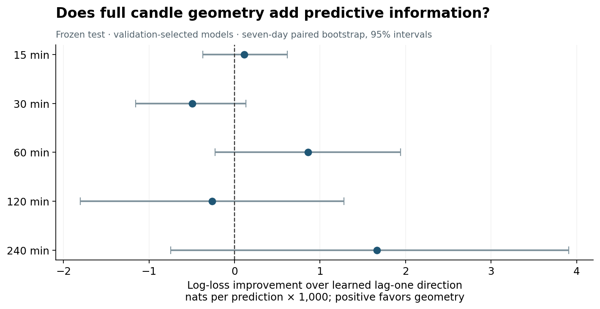
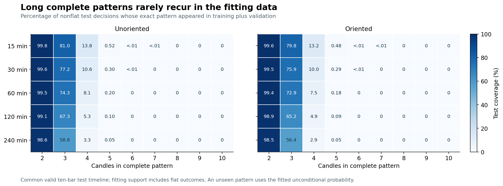

# Bitcoin next-bar direction from complete candle geometry

## Finding

**This experiment does not establish incremental next-bar directional information beyond the learned lag-one direction baseline.** All five validation-selected primary models use two candles and smoothing strength `alpha=100`. Their test accuracies range from 51.61% to 52.88%, but the corresponding lag-one baseline already achieves 51.70%–52.86%. Every primary seven-day confidence interval for improvement includes zero; no primary Holm-adjusted p-value is below 0.05.

Longer exact configurations rapidly exhaust the available repetition. With five candles, only 0.052%–0.519% of test events match a configuration seen during fitting. With eight, nine, or ten candles, no test configuration was previously observed. Those models therefore use the fitted unconditional probability throughout test.

These findings concern the declared **exact-configuration lookup model**. The representation preserves every endpoint-order relationship, but this experiment does not enumerate every Boolean rule or every useful partial projection of that representation. Sparsity in complete identities does not prove that coarser qualitative relationships contain no information.

The numerical results below come from [analysis.json](analysis.json). [Selected models](selected.csv) and [all candidates](candidates.csv) provide machine-readable tables. The [full independent audit](verification.json) passed, and the [matched six-run benchmark](benchmark.json) verified identical scientific output across worker counts. [manifest.json](manifest.json) binds the retained report artifacts by checksum.

## Data and experiment fixed before outcomes

The [protocol](protocol.json) pins five public Vaquum Hugging Face datasets by repository, immutable revision, filename, SHA-256, and expected size. [Preparation provenance](provenance.json) records the verified source files, prepared CSV hashes, and timestamp audit. The analysis records protocol SHA-256 `065b1f3c31908537cc8b274cff4699b90852381bc54f2c39ab039776ca7fb7bf`.

| Bar interval | Source rows | Missing grid bars | Binary primary test events | Flat primary test targets excluded |
|---|---:|---:|---:|---:|
| 15 minutes | 237,149 | 163 | 61,880 | 39 |
| 30 minutes | 118,576 | 80 | 30,945 | 14 |
| 60 minutes | 59,294 | 34 | 15,479 | 0 |
| 120 minutes | 29,653 | 11 | 7,739 | 0 |
| 240 minutes | 14,831 | 1 | 3,869 | 0 |

The sources contain **459,503 actual candles**, spanning 2020-01-01 through 2026-10-07. A missing grid bar is an absent scheduled candle, not necessarily a separate gap episode. The adapter preserves actual rows. Every feature window and subsequent target crossing a gap is excluded; no prices are filled and no time gaps are compressed.

The chronological phases are:

- **Training:** 2020-01-01 through 2023-12-31.
- **Validation:** calendar year 2024.
- **Test:** 2025-01-01 through 2026-10-07; the exclusive end is 2026-10-08.

Candle timestamps denote opening times. At candle `t`'s close, the feature contains candles `t,t-1,...,t-n+1`, ordered current-first. The primary label is `sign(close[t+1] - close[t])`; the secondary label is `sign(close[t+1] - open[t+1])`. The next candle must close within the same phase as the decision candle. Feature history may reach into the preceding phase because it is already observable.

All candidates use the common valid ten-candle decision timestamps for validation and test, making their comparisons paired on the same future outcomes. Each geometry still fits on all its eligible earlier occurrences. This is a retrospective test held out from this experiment's fitting and selection. Some historical data were examined in earlier Filang work; this record does not describe the test as previously untouched external evidence.

## Model and selection

Each complete configuration records dense global ranks for `[low, body_bottom, body_top, high]`. Endpoint equalities retain absent wicks and flat bodies. Both unoriented geometry and geometry retaining up/down/flat body direction are evaluated. Volume, absolute price, wick ratios, indicators, and target-candle features are absent from the inputs.

For a pattern with fitting counts `up` and `down`, the probability estimate is:

\[
P(\mathrm{next\ up}\mid\mathrm{pattern})
=\frac{\mathrm{up}+\alpha p_0}{\mathrm{up}+\mathrm{down}+\alpha},
\qquad
p_0=\frac{U+0.5}{U+D+1}.
\]

The shared unconditional prior and baselines use all eligible two-candle fitting events within their timeframe and target. The learned lag-one baseline conditions on the current close-return sign; the learned body baseline conditions on the current body's sign. Both use Jeffreys smoothing within each sign category, including a separate flat-current category.

The design contains 90 maps: five timeframes × nine lengths × two orientation modes. Two targets and four fixed alphas `[1,10,100,1000]` produce **720 candidate fits**. Validation log loss selects one candidate per timeframe and target. Losses within `1e-12` of the minimum tie; preference is fewer candles, unoriented geometry, then smaller alpha. Selected geometry counts and baselines refit on training plus validation and remain frozen throughout test.

Down/flat/up counts remain in every native map. Binary estimation and scoring exclude exactly flat targets. Probability at least 0.5 predicts up. Log loss is primary; Brier score, accuracy, balanced accuracy, support, and rarity are also retained. All-candidate test results are descriptive and do not select the reported models.

## Primary result: close-to-close direction

Define improvement as `lag1 log loss − geometry log loss`, so a positive value favors geometry. The improvement and interval columns below use **10⁻³ nats per binary prediction**. `U` denotes unoriented geometry and `O` denotes oriented geometry. All selected alphas are 100.

| Minutes | Selected model | Geometry accuracy | Lag-one accuracy | Log-loss improvement | Seven-day 95% interval | Holm p |
|---|---|---:|---:|---:|---:|---:|
| 15 | 2 candles, U | 51.8180% | 51.8714% | +0.1131 | [−0.3709, +0.6177] | 1.0000 |
| 30 | 2 candles, U | 51.6109% | 51.9567% | −0.4936 | [−1.1570, +0.1355] | 1.0000 |
| 60 | 2 candles, U | 51.7992% | 51.6958% | +0.8597 | [−0.2256, +1.9430] | 0.2599 |
| 120 | 2 candles, O | 51.9835% | 52.1773% | −0.2632 | [−1.8019, +1.2810] | 1.0000 |
| 240 | 2 candles, O | 52.8819% | 52.8560% | +1.6645 | [−0.7438, +3.9090] | 0.3178 |



The largest positive probability-score estimates occur at 60 and 240 minutes, with substantial uncertainty around both. Geometry's accuracy changes versus lag one are −0.0533, −0.3458, +0.1034, −0.1938, and +0.0258 percentage points respectively. All paired accuracy intervals also include zero. At 240 minutes, the geometry model makes **2,046 correct classifications versus 2,045** for lag one across 3,869 binary targets.

### Why exceeding 50% is insufficient here

The fitting data favor reversing the current return's sign at every timeframe. Consequently, the learned lag-one classifier behaves like a reversal classifier on nonflat current returns. The test also contains this tendency:

| Minutes | Fitted unconditional accuracy | Current-return momentum accuracy | Current-return reversal accuracy | Learned current-body accuracy |
|---|---:|---:|---:|---:|
| 15 | 49.8335% | 48.1145% | 51.8855% | 51.8811% |
| 30 | 50.6156% | 48.0456% | 51.9544% | 51.9632% |
| 60 | 50.1454% | 48.3042% | 51.6958% | 51.6894% |
| 120 | 50.7818% | 47.8227% | 52.1773% | 52.1773% |
| 240 | 50.4523% | 47.1440% | 52.8560% | 52.8560% |

Momentum and reversal abstain when the current return is flat; their denominators therefore differ slightly from the learned baseline at 15 and 30 minutes. The fitted unconditional model predicts up in every timeframe, using its fitting-period estimate rather than choosing the test-period majority retrospectively.

The exploratory comparison to the unconditional model has positive seven-day log-loss intervals at 15 and 240 minutes. That supports a weaker statement than improvement beyond autocorrelation. The primary comparator already incorporates the current return's sign, and those primary intervals include zero. Accuracy, probability calibration, and economic profit are separate quantities; this classification experiment measures no trading return.

## Support across every window length

This table gives the **minimum–maximum across all five timeframes and both modes** at each length. It preserves the ten strata as a range; it does not pool their correlated observations. Alpha is chosen on validation within each length/mode; support itself is independent of alpha.

“Seen” means the test configuration has at least one training-plus-validation occurrence. Support counts all fitting occurrences, including flat targets. “Singleton” describes a distinct fitting identity observed exactly once. Test coverage is weighted by binary test events; singleton rates are weighted by identities within each stratum.

| Candles | Test events seen during fitting | Test events with ≥20 fitting occurrences | Fitting identities that are singletons |
|---|---:|---:|---:|
| 2 | 98.4751%–99.7867% | 91.9240%–96.6645% | 18.9427%–32.8294% |
| 3 | 56.3712%–80.9567% | 2.5071%–29.7786% | 53.1506%–72.2462% |
| 4 | 2.9207%–13.8478% | 0%–0.3361% | 94.1631%–98.8052% |
| 5 | 0.0517%–0.5187% | 0% | 99.7814%–99.9817% |
| 6 | 0%–0.0097% | 0% | 99.9954%–100% |
| 7 | 0%–0.0016% | 0% | 100% |
| 8 | 0% | 0% | 100% |
| 9 | 0% | 0% | 100% |
| 10 | 0% | 0% | 100% |



Three-candle configurations retain some repetition, but most have little support. By five candles, nearly every test event takes the unconditional fallback. The isolated seven-candle recurrence is one 15-minute test event per orientation mode; all fitting seven-candle identities remain singletons.

The complete oriented ten-candle universe contains `44121589533882676853417959154810808313579452` identities. The maps store every observed identity and an exact symbolic complement for all absent identities. The complement has zero empirical observations; a known cardinality does not supply pattern-specific evidence. No pattern is silently sampled from that universe.

This distinguishes representational completeness from statistical generalization. An exact long configuration can be unique while sharing informative subrelationships with other configurations. Learning those shared subrelationships would require a separately specified model, such as partial endpoint predicates or projections, and its own selection and evaluation protocol.

## Secondary body target and block sensitivity

The secondary target selects the same length, orientation, and alpha as the primary target in every timeframe. Its comparator is the learned current-body baseline. Units again are 10⁻³ nats per binary prediction.

| Minutes | Geometry accuracy | Current-body accuracy | Log-loss improvement | Seven-day 95% interval | Separate exploratory Holm p |
|---|---:|---:|---:|---:|---:|
| 15 | 51.8040% | 51.8784% | +0.0879 | [−0.3945, +0.5972] | 1.0000 |
| 30 | 51.6721% | 51.9629% | −0.5764 | [−1.2528, +0.0580] | 1.0000 |
| 60 | 51.7961% | 51.6863% | +0.8565 | [−0.2307, +1.9459] | 0.2674 |
| 120 | 51.9835% | 52.1773% | −0.2710 | [−1.8128, +1.2760] | 1.0000 |
| 240 | 52.8819% | 52.8560% | +1.6436 | [−0.7518, +3.8756] | 0.3258 |

Inference uses paired daily loss differences over 645 UTC target days, retaining empty days and weighting by the number of binary observations. The fixed circular moving-block bootstrap draws 2,000 resamples with seed `20261008`. The one-sided p-value uses a centered-null distribution; the primary family applies Holm correction across the five selected close-to-close tests. These are conditional uncertainty estimates for the frozen fitted models on this retrospective period.

The predeclared one- and 28-day sensitivities preserve the primary conclusion: all corresponding log-loss intervals include zero. Raw primary p-values are:

| Minutes | 1-day blocks | 7-day blocks | 28-day blocks |
|---|---:|---:|---:|
| 15 | 0.3268 | 0.3398 | 0.3163 |
| 30 | 0.9255 | 0.9320 | 0.9245 |
| 60 | 0.0560 | 0.0520 | 0.0775 |
| 120 | 0.6362 | 0.6312 | 0.6602 |
| 240 | 0.1014 | 0.0795 | 0.0645 |

## Execution and performance evidence

The first complete corpus run produced **90 maps, 8,264,502 task-events, 6,631,446 observed pattern records, and 1,194,269,960 scientific output bytes** in the pattern and event tables. A task-event is one eligible window within one length/mode/timeframe task and carries both target labels. These overlapping task-events are not independent market observations.

The sum of the five native child runtimes was **13.237869 seconds in one observed run**, with maximum per-child peak resident memory **482,295,808 bytes (459.95 MiB)** on an Apple M1 Max with 10 logical cores and 64 GiB RAM. [The performance summary](performance-summary.json) retains each timeframe's work and timing; [hardware and code identities](hardware-and-code.json) record the measured environment. Native timing includes CSV reading, encoding, aggregation, and durable output. Source download, preparation, build, statistical analysis, and independent verification are separate stages. This single first-run measurement is not a repeated timing estimate.

### Matched repeated benchmark

The matched benchmark covers all 18 maps in the 15-minute dataset: lengths 2–10 in both modes. Each run processes **4,266,918 task-events** and writes **615,434,970 scientific bytes**. The one- and ten-worker settings each have three fresh measurements; worker order rotates across repeats.

| Workers | Repeat 1 | Repeat 2 | Repeat 3 | Median elapsed | Maximum peak RSS |
|---|---:|---:|---:|---:|---:|
| 1 | 12.937298 s | 15.471709 s | 13.123019 s | 13.123019 s | 64.70 MiB |
| 10 | 3.479634 s | 3.871250 s | 2.455942 s | 3.479634 s | 468.02 MiB |

The measured median elapsed speedup is **3.7714×**. Every `patterns.tsv` and `events.tsv` file is byte-identical across all six runs. [benchmark.json](benchmark.json) retains the commands, individual timing/CPU/memory records, work counts, output sizes, and full scientific-file hashes. [benchmark-main-equivalence.json](benchmark-main-equivalence.json) records equivalence with the corresponding original corpus output.

The ten-worker runs' median CPU occupancy is **2.832 cores**. This includes I/O and durable writes and does not establish CPU saturation or an absolute throughput ceiling. The results demonstrate the measured parallel benefit and its additional memory cost on this machine.

### Independent verification

**The complete historical audit passed.** The [verification receipt](verification.json) records all **90 tasks and 8,264,502 events**, with every canonical geometry reconstructed independently from the source CSV. It verifies target/current direction labels, gap and boundary exclusions, pattern identities, split counts, exact universe/complement counts, and artifact checksums.

The statistical audit independently recomputed **1,440 candidate-period scores** and all **10 selected models**, including shared baselines, validation-only selection, frozen probabilities, every daily paired sum, the primary comparator's 1/7/28-day bootstrap results, and both Holm families. Maximum absolute metric discrepancy was **1.2789769243681803 × 10⁻¹³**. The independent verification took **238.066981 seconds**, outside the native performance timer.

The verifier sorts distinct endpoint prices to reconstruct canonical ranks and uses occupied-level inclusion/exclusion with arbitrary-precision integers for domain counts. These are independent implementations of the native encoder and chain-merging counter. The statistical verifier also uses a separate prefix-sum bootstrap implementation. This is exhaustive reconstruction of the recorded historical events, not a sampled geometry audit. [Local validation receipts](validation/receipt.json) retain the Rust and Python checks, with their complete logs. Final pull-request CI separately checks the published source on Linux and macOS.

## Reproduce

The [experiment reference](../../../experiments/geometry_direction/README.md) documents setup, pinned dependencies, native schemas, resource limits, and resume behavior. From the repository root:

```sh
python3 scripts/run_direction_experiment.py \
  --protocol experiments/geometry_direction/protocol.json \
  --out runs/bitcoin-direction-reproduction \
  --workers 10
```

The default `all` stage prepares the exact sources, builds the release executable, maps all 90 tasks, performs the frozen analysis, and runs exhaustive verification. Use a fresh output directory. A resumed run is for recovery and is not a fresh performance observation.

The matched native benchmark is independently repeatable:

```sh
python3 scripts/benchmark_direction.py \
  --out runs/bitcoin-direction-benchmark-reproduction \
  --workers 1,10 --repeats 3 --timeframes 15
```

Scientific identities, dates, counts, and checksums bind the retained evidence. Large event/pattern files remain in the reproducible run directories; this report retains compact results and receipts rather than duplicating those files in Git.

`scripts/collect_direction_report.py` reproduces this compact evidence package and verifies benchmark equivalence to the audited run. `scripts/plot_direction.py` renders the figures directly from the completed analysis. Their commands and dependencies are included in the experiment reference.
